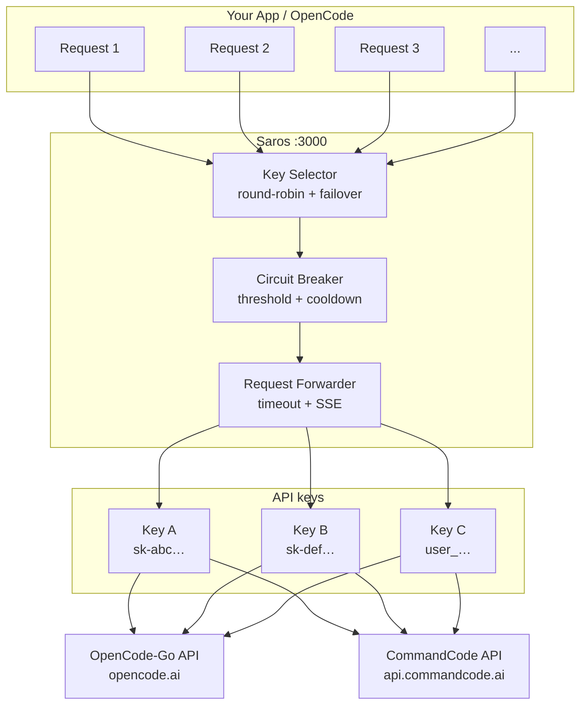

# Saros

[](https://github.com/vitorvilaca3011/saros-proxy/actions/workflows/ci.yml)
[](https://www.npmjs.com/package/saros-proxy)
[](https://opensource.org/licenses/MIT)
[](https://nodejs.org/)

Saros — like the eclipse cycle, this proxy predicts exhaustion and rotates accounts before they run out. Built for the OpenCode-Go API, now multi-provider.

Manage multiple API keys behind a single endpoint — OpenCode-Go **and** CommandCode keys can live in the same pool. When one key gets rate-limited, revoked, or returns server errors, the proxy automatically fails over to the next healthy key — zero downtime.

---

## Contents

- [Features](#features)
- [Architecture](#architecture)
- [Installation](#installation)
  - [Prompt Install](#prompt-installfor-the-lazy-ones)
  - [Quick Install (npm)](#quick-install-npm)
  - [From Source](#from-source)
  - [Docker](#docker)
  - [Setup Wizard](#setup-wizard)
- [Configuration Reference](#configuration-reference)
- [Usage Examples](#usage-examples)
- [OpenCode Integration](#opencode-integration)
- [Multi-Harness Integration (pi, oh-my-pi & dsh)](#multi-harness-integration-pi-oh-my-pi--dsh)
- [Troubleshooting](#troubleshooting)
- [Development](#development)
- [Security](#security)
- [License](#license)

---

## Features

- **Multi-provider keys** — Mix OpenCode-Go (`oc_sk_…` / legacy `sk-…`) and CommandCode (`user_…` / `sk-…`) keys in one pool.
- **Paste-a-key setup** — Drop any text containing keys into the setup wizard; Saros extracts them and identifies the provider by pinging each provider's API (smoke test).
- **Multi-key rotation** — Round-robin across all your API keys.
- **Auto failover** — Retry failed requests with the next healthy key.
- **Circuit breaker** — Disable flaky keys after a configurable threshold, then lazily re-enable them after cooldown.
- **Streaming support** — SSE passthrough with mid-stream error detection.
- **Request timeout** — Configurable timeout with a clean 504 response.
- **Graceful shutdown** — Drains active requests before exiting (no dropped connections).
- **Security hardening** — API key masking in logs, SSRF prevention (HTTPS-only upstream), configurable CORS, host binding validation.
- **Config validation** — CLI args, YAML file, or environment variables with sensible defaults.
- **Health endpoint** — `GET /health` shows key status per key (enabled, why it is out of rotation, when it retries), active requests, circuit-breaker state, and the running package version.
- **Request forensics** — `X-Proxy-Provider` / `X-Proxy-Key-Label` / `X-Proxy-Request-Id` headers on served responses, plus `GET /debug/recent` (last 200 requests in memory, no credentials).
- **No database** — Stateless proxy, zero external dependencies beyond Node.js.

---

## Architecture



### How Request Distribution Works

Here's how Saros picks which API key to use:

#### Usage-Weighted Rotation

Saros polls each key's quota endpoint and weights rotation by **remaining
monthly** quota — but the monthly number it weighs is the one implied by the
**tightest quota window**, not the calendar-month counter alone. Each window is
a fraction of the monthly allowance (5-hour = 20%, weekly = 50%, monthly =
100%), so every window's percent is scaled onto the monthly scale and the
largest one becomes the effective usage:

```
effective = max(monthly%, 0.5 × weekly%, 0.2 × rolling%)
weight    = 100 − effective
```

A key with monthly 10% but weekly 99% is really at 49.5% of the month
(`max(10, 49.5, 0)`) and weighs 50.5, while a key with monthly 20% and weekly
10% weighs 80 — the healthy key gets the traffic, even though the monthly
counter of the strained key looks roomier. When no shorter window is tighter
(monthly 28%, weekly 2%, rolling 0%), the effective usage is still 28% and the
weight is the old 72. `saros-proxy usage` and `/health` keep showing the
monthly percentage; only the rotation weight uses the combined number.

If key X is 30% into its monthly allowance and key Y is 70%, 10 requests are
distributed 7 → X and 3 → Y — proportional balancing, not hard cutoffs, so
neither key absorbs the full load when the other runs low.

The number Saros compares is always a percentage of that key's **own provider
monthly budget**, never absolute capacity:

| provider | endpoint | what it reports |
| --- | --- | --- |
| OpenCode Go | `GET /zen/go/v1/usage` | `rolling` (5h) / `weekly` / `monthly` as percents |
| CommandCode | `GET /alpha/billing/credits` | `fiveHour` and `weekly` as `used`/`cap` in credits, `credits.monthlyCredits` (remaining) and reset timestamps |

CommandCode's payload has no explicit monthly cap. The parser **infers** it
from the window caps (the 20% / 50% / 100% ladder is OpenCode Go's documented
plan shape; for CommandCode the 14/35 ratio was measured against its
dashboard): monthly cap = 2 × `weekly.cap`, falling back to 5 ×
`fiveHour.cap` when the weekly window is absent. The candidate cap is only
accepted when the credits agree with it — `credits.monthlyCredits <= cap` and
`cap − monthlyCredits >= max(weekly.used, fiveHour.used)`; otherwise the
fallback is tried and, if it also disagrees, the response is treated as
unusable (the previous usage state is kept rather than branding a broken
derivation as 0% usage). A payload without `monthlyCredits` reports the
monthly metric as unavailable (`n/a` in `saros-proxy usage`). Both parsers
emit the same 0-100 percent scale, so a mixed pool compares like with like.
Two consequences worth knowing:

- **The tightest window is the weight; a spent window still excludes the key.**
  Monthly 10% with weekly 99% weighs 50.5, not 90. A key with any 5-hour,
  weekly or monthly window at 100% weighs 0 and is not selected while another
  key has room — otherwise it would keep receiving traffic and failing
  upstream. `/health`'s `usagePercent` is the monthly number.
- **Percent is all there is.** OpenCode Go publishes percents only — no counts,
  no caps — so "remaining capacity" in tokens or dollars cannot be derived.

- Refreshed in the background every 60s (stale data keeps working).
- Keys without usage data take the **median of the other keys' non-exhausted
  weights**, not plain round-robin. Round-robin is only the fallback when no
  key has usage data at all (or when every key is exhausted and a request must
  share one).
- A key whose account has no plan for its provider (403 `EntitlementError` /
  `upgrade_required` from the usage endpoint) is dropped from rotation without
  tripping the circuit breaker, and returns as soon as a later refresh sees it
  working. `/health` reports `entitledCount`.

#### Token Accounting

Every forwarded response's token usage is recorded per key: streaming requests
get `stream_options: {"include_usage": true}` injected (unless the client set
the option itself), and the final `usage` chunk — or the top-level `usage`
object for non-streaming bodies — is booked against the key that served the
request. Totals are persisted to `~/.config/saros/token-usage.json` (debounced
atomic writes) and shown by `saros-proxy usage`.

This is the fallback signal: when a provider has no quota endpoint, or its usage
call fails, absolute token totals and request counts per key are what
`saros-proxy usage` can still show.

#### Circuit Breaker

Keys that return auth/quota errors (`401`, quota `4xx/5xx`) enter a cooldown
and are lazily re-enabled after it expires — or immediately by a successful
response through the same key, which happens when tier 2 shares one key between
concurrent requests and only one of them fails. Timeouts and connection errors do
**not** disable keys — they are shared-upstream failures, so Saros keeps
cycling instead of locking up with "all keys unavailable".

#### Concurrent Request Safety

Saros tracks which keys are currently in use. A key handling a streaming request won't get assigned another one until it finishes. No double-booking.

## Installation

### Prompt Install(for the lazy ones)

Don't feel like reading through everything? Copy this prompt and paste it to your AI assistant. It'll read [`docs/LLM_INSTRUCTIONS.md`](docs/LLM_INSTRUCTIONS.md) and guide you through setup — no keys shared in chat.

```
Install Saros Proxy for my opencode. (https://github.com/vitorvilaca3011/saros-proxy)
Follow the instructions on docs/LLM_INSTRUCTIONS.md.
```

---

### Quick Install (npm)

```bash
npm install -g saros-proxy
```

### From Source

```bash
git clone https://github.com/vitorvilaca3011/saros-proxy.git
cd proxy
npm install
npm run build
```

> **Requirements:** Node.js >= 22.0.0

---

### Docker

Run in a clean Linux container without installing Node.js locally.

#### Prerequisites

- [Docker](https://docs.docker.com/get-docker/) (Compose v2)

#### Quick start

```bash
# 1. Create config.yaml from the example (edit with your keys)
cp config.example.yaml config.yaml

# 2. Build the image
npm run docker:build

# 3. Start the proxy
npm run docker:run
```

The proxy is now at `http://127.0.0.1:3000`.

#### Run tests in Docker

```bash
npm run docker:test
```

#### Manual Docker commands

```bash
# Build
docker compose build proxy

# Run in foreground
docker compose up proxy

# Run in background (detached)
docker compose up -d proxy

# View logs
docker compose logs -f proxy

# Stop
docker compose down

# Run tests
docker compose run --rm test
```

#### Configuration with Docker

Mount a custom `config.yaml` or use environment variables:

```bash
# Using env vars (no config.yaml needed)
docker compose run --rm -e OPENCODE_GO_KEYS="home:sk-xxx,work:sk-yyy" proxy

# Or edit docker-compose.yml to set env vars, then:
docker compose up proxy
```

---

### Setup Wizard

The easiest way to get going:

```bash
# If installed globally
saros-proxy setup

# Or with npx
npx saros-proxy setup
```

The wizard will:
1. Ask for your proxy port (default: 3000)
2. Offer a **paste-a-key mode**: drop any text containing your keys (a `.env` dump, chat message, notes file) — Saros extracts every key and identifies its provider with a live smoke test, showing the detected provider and plan
3. Ask for your API keys manually if you prefer (typed input also auto-detects `user_` CommandCode tokens)
4. Generate `config.yaml` automatically
5. Run a smoke test to verify everything works
6. Configure opencode.json with provider settings and model definitions

Want to run manually instead? Skip the wizard and just create a `config.yaml`:

```yaml
port: 3000
host: 127.0.0.1
upstreamBaseUrl: https://opencode.ai   # default upstream for opencode-go (sk-) keys
keys:
  - label: primary
    key: sk-your-primary-key-here-12345678        # opencode-go
  - label: secondary
    key: sk-your-secondary-key-here-87654321      # opencode-go
  - label: commandcode
    key: user_your-commandcode-token-here         # commandcode (user_ token)
circuitBreakerThreshold: 3
circuitBreakerCooldownMs: 60000
requestTimeoutMs: 30000
```

Then run:

```bash
# Development (hot reload)
npx tsx src/index.ts

# Production (built)
node dist/index.js
```

Test that it's alive:

```bash
curl http://127.0.0.1:3000/health

# Why is a key out of rotation? The `keys` block says it (never the key itself):
#   "keys": [{"label":"work","provider":"commandcode","enabled":false,
#             "reason":"auth","lastError":{"status":401},
#             "retryAfterMs":43876}]

# Query models
curl http://127.0.0.1:3000/zen/go/v1/models

# Chat completion
curl http://127.0.0.1:3000/zen/go/v1/chat/completions \
  -H "Content-Type: application/json" \
  -d '{"model":"gpt-4","messages":[{"role":"user","content":"Hello"}]}'
```

---

---

## Configuration Reference

Every option can be set via YAML (`config.yaml`), environment variables, or CLI flags. Priority: CLI > YAML > env vars > defaults.

### Options

| Option | CLI Flag | Env Variable | Default | Notes |
|---|---|---|---|---|
| `port` | `--port` | `PROXY_PORT` | `3000` | 1–65535 |
| `host` | `--host` | `PROXY_HOST` | `127.0.0.1` | Bind address |
| `upstreamBaseUrl` | — | `UPSTREAM_BASE_URL` | `https://opencode.ai` | HTTPS only |
| `circuitBreakerThreshold` | — | `CIRCUIT_BREAKER_THRESHOLD` | `3` | Consecutive fails before disabling (1–10) |
| `circuitBreakerCooldownMs` | — | `CIRCUIT_BREAKER_COOLDOWN_MS` | `60000` | Cooldown before re-enabling (1000–3600000) |
| `requestTimeoutMs` | — | `REQUEST_TIMEOUT_MS` | `30000` | Upstream timeout (1000–300000) |
| `allowedOrigins` | — | — | `["http://localhost:*", "http://127.0.0.1:*"]` | CORS origins (`[]` = allow all) |
| `keys` | — | `OPENCODE_GO_KEYS` | — | Array of `{label, key, provider?}` |
| `upstreams` | — | — | provider defaults | Per-provider upstream URL overrides (HTTPS only) |
| `config` | `--config` | — | `config.yaml` | Path to YAML config |

### API Key Format

Saros accepts keys from multiple providers. A key must be at least 20 characters and match one of these formats:

| Prefix | Provider | Notes |
|---|---|---|
| `oc_sk_…` | OpenCode-Go | Minted only by OpenCode since the 2026-10 key rotation — definitive |
| `sk-…` | OpenCode-Go or CommandCode | `sk-` is shared by both providers; Saros infers OpenCode-Go unless an explicit `provider` is set |
| `user_…` | CommandCode | Always detected as CommandCode |

**YAML:**
```yaml
keys:
  - label: my-account
    key: sk-your-key-here...            # opencode-go (default inference)
  - label: cc-account
    key: user_your-token-here...        # commandcode (inferred from prefix)
  - label: cc-console-key
    key: sk-your-console-key-here...    # ambiguous prefix → set provider explicitly
    provider: commandcode
  - label: old-account
    key: sk-you...0000
    enabled: false           # retired: kept in config, never used
```

The `provider` field is optional — it wins over prefix inference and is required only when a CommandCode `sk-` console key must be distinguished from an OpenCode-Go key. When keys are encrypted at rest (prefix hidden), the provider from setup time is persisted alongside.

The `enabled` field is optional (default `true`). Setting `enabled: false` retires a key without deleting it: it never enters rotation, is never counted as a failure, and `/health` reports it as `disabledByConfig: true` (the 503 lists it as `disabled_by_config`). A revoked key is usually better retired than deleted — the credential stays for the record and comes back with a one-word edit.

**Per-provider upstream override (optional):**

```yaml
upstreams:
  commandcode: https://api.commandcode.ai   # default
  opencode-go: https://opencode.ai          # default
```

**Environment variable:**
```bash
OPENCODE_GO_KEYS="account1:sk-xxx,cc:user_yyy"
```

#### How multi-provider routing works

- Clients always speak the canonical OpenCode-Go shapes (`/zen/go/v1/...` or the `/v1/...` alias).
- When a request is served by a CommandCode key, Saros remaps the route to CommandCode's OpenAI-compatible surface (`/provider/v1/...`) and injects the provider's identity headers — transparent to the client.
- Models uniquely named by a provider (e.g. `claude-*` or vendor-prefixed ids on CommandCode) are routed to a key of that provider first; other providers remain as fallback.
- Synced harness configs may list provider-specific models as `model@commandcode`; the suffix selects the provider and is stripped before forwarding. The pin is authoritative: key selection is restricted to that provider, so a pin whose provider cannot serve the model still reaches that upstream and surfaces its error instead of a local 503.
- The `/health` endpoint reports per-provider key counts under `providers`, and a `keys` array with each key's state: `enabled`, `entitled`, `consecutiveFailures`, `disabledAt`, `retryAfterMs`, and `lastError` (`status` + `reason`: `auth`, `quota`, `rate_limit`, `server`). The credential is never part of the response.
- When no key can serve a request, the `503` body says which keys are out and why — `keys[]` with `reason`/`lastStatus`/`retryAfterMs`, plus a `causes[]` list (revoked key, exhausted quota, rate limit, missing plan, or a `@provider` pin with no usable key). The legacy `error` field (`All API keys are temporarily unavailable`) is still present.
- OpenCode-Go requires a stable per-conversation session id (`x-opencode-session`, used for routing and prompt caching). Saros forwards a client-supplied value untouched and derives one from the conversation (model + first user turn) when the client sends none — harnesses that only attach the header on some request paths would otherwise get `400 MissingSessionID`.
- Usage-based weighted rotation uses each provider's queryable usage endpoint (OpenCode-Go `GET /zen/go/v1/usage`, CommandCode `GET /alpha/billing/credits`). Both contribute a monthly percentage of their own budget, and rotation weighs the tightest window scaled to that budget; token consumption stays tracked per key and shown by `saros-proxy usage` (see [Usage-Weighted Rotation](#usage-weighted-rotation) and [Token Accounting](#token-accounting)).

#### Smoke test (key identification)

`identifyKey` verifies a key by pinging each candidate provider with a cheap, read-only request (no token spend): OpenCode-Go `GET /zen/go/v1/usage`, CommandCode `GET /alpha/billing/subscriptions` (which also reports the subscription plan). `200` = valid, `401/403` = rejected, network error = inconclusive. The setup wizard uses this to label pasted keys; you can run it yourself:

```bash
CC_KEY=user_your-token npx tsx scripts/live-identify-check.ts
```

### API Key Encryption

Keys can be stored as `enc:v1:` envelopes instead of plaintext. An envelope is
`enc:v1:<salt>.<nonce>.<tag>.<ciphertext>`: scrypt (N=2^15, r=8, p=1, 32 B)
derives an AES-256-GCM key, and the AAD binds the envelope version and the key
label, so a ciphertext copied onto another key entry fails authentication.

**Encrypt existing plaintext keys** (the old file is copied to
`config.yaml.backup` once; a second run is a no-op; providers are inferred and
persisted so encrypted keys still route correctly):

```bash
saros-proxy keys encrypt
# or: saros-proxy keys encrypt --config /etc/saros/config.yaml
# or: saros-proxy keys encrypt --no-backup
```

The backup is written **in plaintext** (mode 0600) on purpose: it is the
recovery path if the passphrase is lost. Delete it after the first successful
boot, or pass `--no-backup` to skip it. A symlinked config (dotfile setups) is
rewritten through its real target — the link survives and the target is
encrypted.

**Cost of the KDF:** the envelope uses scrypt N=2^15, r=8, p=1 (about 32 MiB
and ~70 ms per key on a current laptop). Boot derives the key once per
encrypted entry, so 10 keys add roughly 0.7 s. Raising N to 2^17 (OWASP's
recommendation) multiplies that boot cost by ~4 per key; do it only together
with a migration, and remember that passphrase entropy — not the KDF — is what
an offline attacker attacks first.

**Passphrase sources, first match wins:**

1. `SAROS_PASSPHRASE` — for systemd, Docker and CI.
2. The OS secret store, accessed only through the platform CLI:
   - Linux: `secret-tool lookup service saros-proxy account "$USER"`
   - macOS: `security find-generic-password -s saros-proxy -a "$USER" -w`
   - Windows: PowerShell DPAPI (`CurrentUser`) over
     `%APPDATA%\saros\secret.dpapi`
3. A hidden TTY prompt — foreground `saros-proxy serve` only, never the daemon
   child and never when stdin is not a TTY.

```bash
saros-proxy secret set      # store the passphrase through the OS CLI
saros-proxy secret status   # which source would win + whether the store is populated
saros-proxy serve           # foreground; may prompt if no source is available
```

`secret set` never writes the passphrase to a file and never prints it; it
warns when the value is shorter than 12 characters (scrypt makes guessing
expensive, but passphrase entropy is what actually protects the keys). On
Linux it is stored with `secret-tool store --label="saros-proxy passphrase"
service saros-proxy account "$USER"`; on macOS with `security
add-generic-password -U -s saros-proxy -a "$USER" -w`; on Windows PowerShell
`ProtectedData.Protect(..., 'CurrentUser')` writes the blob.

`secret status` distinguishes an absent entry (`not found`) from an
unavailable keyring (`keyring locked or error`), and the same reason is carried
into the "no passphrase source" boot error — a locked keyring is not reported
as an empty store.

**systemd-creds recipe** (keeps the passphrase out of the unit file and the
environment of the shell). This is a **system** unit recipe — run the encryption
as root, since the host key lives in `/var/lib/systemd/credential.secret`:

```bash
# One-time, as root: encrypt stdin into a host-bound credential.
# (--with-key=auto picks tpm2+host when the TPM is available, host otherwise.
#  "host+user" is not a valid key type, and --user only exists from v256.)
systemd-creds encrypt --name=saros-passphrase --with-key=auto \
  /dev/stdin /etc/saros/passphrase.cred
```

For the `systemd --user` unit created by `saros-proxy autostart install`, use
`Environment=`/`EnvironmentFile=` instead: user credentials need
`systemd-creds --user`, which only exists from systemd v256 (this host runs 255).

```ini
# /etc/systemd/system/saros-proxy.service
[Service]
LoadCredentialEncrypted=saros-passphrase:/etc/saros/passphrase.cred
ExecStart=/bin/sh -c 'SAROS_PASSPHRASE="$(cat "$CREDENTIALS_DIRECTORY/saros-passphrase")" exec /usr/bin/saros-proxy serve'
```

**Behaviour and compatibility:**

- Plaintext keys keep working; startup logs a loud warning and
  `keys encrypt` fixes them.
- A config with `enc:v1:` values and no available source exits `1` with a
  message naming the three options. A wrong passphrase also exits `1` and
  names the key label — never the key or the passphrase.
- `GET /health` reports `"encrypted": true` per key; it never returns the
  ciphertext or the plaintext. The flag is derived from the value being an
  envelope — an `encrypted: true` field on a plaintext entry is stripped, so
  the signal cannot be spoofed from YAML.
- Legacy `enc:scrypt:` keys still decrypt with `OPENCODE_GO_ENCRYPTION_KEY`
  (with a warning); `keys encrypt` leaves them untouched.
- `OPENCODE_GO_KEYS` is always plaintext (CI use) and is not covered by the
  warning.
- Docker can pass `SAROS_PASSPHRASE` or mount a config whose passphrase comes
  from a Docker secret; the container has no OS keyring of its own.

The honest threat model — what each option protects and what it does not — is
in [Security](#security).

### CLI Flags

```bash
tsx src/index.ts --config my-config.yaml --port 4000 --host 0.0.0.0
```

---

## Usage Examples

### Basic: YAML config

```bash
# Create config.yaml, then:
npx tsx src/index.ts
```

### Advanced: Environment variables only

```bash
export PROXY_PORT=4000
export PROXY_HOST=127.0.0.1
export OPENCODE_GO_KEYS="home:sk-abc123...,work:sk-def456..."
export CIRCUIT_BREAKER_THRESHOLD=5
export CIRCUIT_BREAKER_COOLDOWN_MS=120000
export REQUEST_TIMEOUT_MS=45000
export LOG_LEVEL=debug

npx tsx src/index.ts
```

### Custom config path

```bash
npx tsx src/index.ts --config /etc/saros/config.yaml
```

### Run as background daemon (all platforms)

The proxy ships with a built-in daemon. Once installed globally (`npm install -g saros-proxy`):

```bash
# Show the overview (running state, harnesses, API keys, config path)
saros-proxy

# Start the daemon (background)
saros-proxy start --port 3000

# Check status
saros-proxy status

# Stop it
saros-proxy stop

# Add harnesses to the model-sync selection (omp|ohmypi, pi, oc|opencode, dsh)
saros-proxy configharness omp pi oc dsh

# Remove a harness, or disable sync entirely
saros-proxy configharness --remove pi
saros-proxy configharness --clear

# List the current harness selection
saros-proxy configharness

# Probe model capabilities (liveness, reasoning, tool calling)
saros-proxy probe [model-id]

# Probe all models
saros-proxy probe

# Show per-key quota usage, token totals and most-used models
saros-proxy usage

# Install autostart (Linux: systemd --user; Windows: VBS script or Registry)
saros-proxy autostart install [--port <port>] [--method systemd|vbs|registry|auto]

# Uninstall autostart
saros-proxy autostart uninstall [--method systemd|vbs|registry|auto]

# Check autostart status
saros-proxy autostart status [--method systemd|vbs|registry|auto]

# Update a global npm install: stop, npm install -g, start again, verify
saros-proxy update
saros-proxy update --check          # only compare installed vs npm latest (exit 1 when outdated)
saros-proxy update --yes --force    # no prompt; --force allows a non-global checkout
saros-proxy update --port 3100      # restart the daemon that serves 3100, not the default port
```

On Linux the default is a `systemd --user` unit at
`~/.config/systemd/user/saros-proxy.service` (honouring `$XDG_CONFIG_HOME`), enabled
with `systemctl --user enable` and restarted with `systemctl --user restart`. On
Windows the default is AV-aware (`auto`): Registry when third-party antivirus is
detected, otherwise the Startup-folder VBS.

Manage the unit with systemd, not with the CLI: `saros-proxy stop` exits non-zero
while the service still answers `/health`, because the CLI does not own the unit's
process. `saros-proxy update` is the one exception, and on purpose: when the unit is
active it stops and starts the proxy through `systemctl --user` instead of the PID
file, so an update does not fight the unit's restart policy.

```bash
systemctl --user start|stop|restart|status saros-proxy.service
journalctl --user -u saros-proxy -f
```

The unit runs `serve` in the foreground: without a TTY it cannot prompt for a
passphrase, and the user manager does not inherit the environment of the shell
that ran `install`. If `config.yaml` holds `enc:v1:` envelopes, give the unit a
source through a drop-in (`systemctl --user edit saros-proxy.service`):

```ini
[Service]
Environment=SAROS_PASSPHRASE=your-passphrase
```

`EnvironmentFile=-%h/.config/saros/env` (mode 0600) keeps the value out of the
unit file. A credential is stronger, but `Environment=` can only carry the
credential *path* (`%d/<name>`), never its content — see the
[systemd-creds recipe](#api-key-encryption), which wraps `serve` in
`sh -c 'SAROS_PASSPHRASE="$(cat "$CREDENTIALS_DIRECTORY/<name>")" exec …'`.
`systemd-creds` only gained a `--user` mode in v256.

The `start` command automatically syncs model definitions to all enabled harnesses (see [Multi-Harness Integration](#multi-harness-integration-pi-oh-my-pi--dsh)).

### Model Sync Commands

Saros keeps your harness configs in sync with the provider APIs. Which harnesses are synced is opt-in via the harness selection (see [Multi-Harness Integration](#multi-harness-integration-pi-oh-my-pi--dsh)).

```bash
# List which harnesses are enabled for model sync
saros-proxy configharness

# Add oh-my-pi, pi, OpenCode, and dsh to the sync selection (additive)
saros-proxy configharness omp pi oc dsh

# Remove a harness, or disable sync entirely
saros-proxy configharness --remove pi
saros-proxy configharness --clear

# Sync the live model list from upstream into all enabled harnesses
saros-proxy sync-models

# Probe model capabilities
saros-proxy probe [model-id]

# Probe all configured models
saros-proxy probe

# Show per-key quota usage, token totals and most-used models
saros-proxy usage
```
`sync-models` fetches the live model list from upstream and writes it to each enabled harness, with metadata from models.dev.
It only touches `providers["saros-proxy"].models` in the target configs; a harness whose config file does not exist is reported as a failure, never created.
`saros-proxy start` runs the same sync on boot and logs one line per harness (`omp synced to …`, `omp: <error>`), so a daemon started that way only needs `configharness`.
The autostart unit is the exception: it runs `saros-proxy serve` (Linux) or a hidden `start` (Windows), so it does not run the harness sync at boot — after changing the selection there, run `saros-proxy sync-models` (or `saros-proxy restart`) once.
The old name `sync-upstream` still works as a deprecated alias.
`probe` tests each model's liveness, reasoning, and tool-calling capabilities via the proxy.

**Daemon config path:** By default the daemon looks for `config.yaml` at:
- Linux/macOS: `~/.config/saros/config.yaml`
- Windows: `%LOCALAPPDATA%\saros\config.yaml`

Override with `--config`:
```bash
saros-proxy start --port 3000 --config /path/to/config.yaml
```

The PID file, `daemon.log` and captures live in the same directory as `config.yaml` — `~/.config/saros/` on Linux/macOS, `%LOCALAPPDATA%\saros\` on Windows. An installation started before 0.11.0 keeps its pid under `~/.config/saros`; set `SAROS_ALLOW_LEGACY_PID=1` once to stop it, or the new layout takes over on the next start. Without the flag the pre-0.11 PID file is inert — it is never read, migrated or deleted (only `stat`ed, so `stop`/`status` can name it and point at `SAROS_ALLOW_LEGACY_PID=1`) — because that path lives in the operator's real home and an isolated run (a test with a temp config dir, a throwaway container shell) must not signal a live daemon. With the flag set, a live legacy PID is read and migrated into the new directory on first use. `saros-proxy stop` removes the PID file only once the process is confirmed gone: when the kill fails it keeps the handle and exits non-zero, so the next `stop` still finds the daemon (instead of printing "no running proxy daemon" and exiting 0) and `restart` never announces a stop it could not confirm nor start over a busy port. A failed stop also names the exact file it acted on, and removing it never touches the other layout's handle. When the state dir holds no PID but a pre-0.11 one exists, `stop` says where it is and exits non-zero if something still answers `/health` on the configured port — an upgraded install cannot be reported as stopped while it still serves. The child process runs with `NODE_ENV=production` (JSON/NDJSON logging), and **both** its stdout (pino) and stderr are appended to `daemon.log` — the same descriptor for both, with no pipe whose read end the exiting launcher could take away. The file rotates at start: past 10 MB it becomes `daemon.log.1` and up to five are kept. Every boot writes an `evt:"boot"` line — version, node, config path, port, key labels/providers, bundled model count — so an empty log now means the daemon never started, not that logging is silent. When a fresh child dies during startup, `saros-proxy start` reads the lines this boot appended to that same log and reports the reason (`EADDRINUSE`, missing API keys, or the last six lines) before exiting non-zero.

`saros-proxy status` checks the PID file first, then falls back to an os-agnostic `GET /health` port probe — so it reports the truth even when the proxy was started outside the daemon (manually, via autostart, or in another session) and no PID file exists. It also prints the enabled harnesses (`configharness` selection) and, from the daemon's `/health` payload, one line per key with its state (`Keys: 1/2 enabled`, then `work [commandcode] — disabled: auth (401), retry in 42s`). `saros-proxy start` refuses to start a second instance when the configured port is already serving. `saros-proxy stop` exits non-zero whenever something still answers `/health` on the configured port, even when it has no PID file to remove — the process was started outside the daemon or lost its handle.

Every request writes exactly one `evt:"request.complete"` line (requestId, path, model, provider, keyLabel, status, durationMs, stream, attempt), with key selection at `debug` and upstream failures at `warn`. The full event and redaction contract is in [docs/logging.md](docs/logging.md).

Bare `saros-proxy` (no subcommand) prints the same overview without starting anything: running state, harnesses, masked API keys, and config path. To run the proxy in the foreground (e.g. for development or in a container), use `saros-proxy serve [--port <port>] [--config <path>]` — the daemon child and the Docker entrypoint run `serve` under the hood.

---

## OpenCode Integration

Configure OpenCode to route API requests through the proxy. Edit your OpenCode config file at `~/.config/opencode/opencode.json` (global) or `opencode.json` in your project root:

```jsonc
{
  "$schema": "https://opencode.ai/config.json",
  "provider": {
    "saros-proxy": {
      "npm": "@ai-sdk/openai-compatible",
      "name": "Saros",
      "options": {
        "baseURL": "http://127.0.0.1:3000/zen/go/v1",
        "apiKey": "not-used"
      },
      "models": {
        "glm-5": { "name": "GLM-5" },
        "kimi-k2.5": { "name": "Kimi K2.5" },
        "qwen3.7-plus": { "name": "Qwen 3.7 Plus" }
      }
    }
  }
}
```

**Key points:**
- `baseURL` must end at `/v1` — OpenCode appends route paths internally
- `apiKey` can be anything — the proxy handles real key selection
- Model IDs must match what upstream expects (e.g., `glm-5`, not `opencode-go/glm-5`)
- Restart OpenCode after editing the config

**Alternative: Environment variable substitution**

```jsonc
{
  "provider": {
    "saros-proxy": {
      "npm": "@ai-sdk/openai-compatible",
      "name": "Saros",
      "options": {
        "baseURL": "{env:OPENCODE_PROXY_URL}",
        "apiKey": "{env:OPENCODE_PROXY_KEY}"
      }
    }
  }
}
```

Then set: `export OPENCODE_PROXY_URL=http://127.0.0.1:3000/zen/go/v1`

**Using the proxy in OpenCode:**

Select the proxy provider in OpenCode's model picker, or set it as default:

```jsonc
{
  "provider": { /* ... as above ... */ },
  "model": "saros-proxy/glm-5"
}
```

---

## Multi-Harness Integration (pi, oh-my-pi & dsh)

Besides OpenCode, Saros can keep its provider + model config in sync for the `pi`, `oh-my-pi` (`omp`), and DeepSeek Harness (`dsh`) harnesses. They use different config files:

| Harness | Config file | Format |
|---|---|---|
| OpenCode | `~/.config/opencode/opencode.json[.jsonc]` | JSON/JSONC |
| pi | `~/.pi/agent/models.json` | JSON |
| oh-my-pi (`omp`) | `~/.omp/agent/models.yml` | YAML |
| DeepSeek Harness (`dsh`) | `~/.dsh/profiles/web/cordis.patch.yml` | YAML (patch layer) |

Sync is opt-in per harness, configured with the `configharness` command. The selection is stored in `~/.config/saros/harnesses.json`:

```bash
# Add omp + pi + opencode + dsh to the sync selection (additive)
saros-proxy configharness omp pi oc dsh

# Remove a harness, or disable sync entirely
saros-proxy configharness --remove pi
saros-proxy configharness --clear

# See the current selection
saros-proxy configharness

# Accepted names: omp | ohmypi, pi, oc | opencode, dsh
```

`configharness` is additive: each command adds the named harnesses to the current selection (running `configharness omp` then `configharness pi` enables both). Use `--remove <h>...` to disable specific harnesses or `--clear` to disable sync for every harness.

Behavior:

- If `harnesses.json` does not exist, only OpenCode is synced (the default).
- An explicit empty selection (`{"harnesses":[]}`) disables sync entirely.
- Sync never creates a harness config: a harness whose config file is missing is reported as a failure, not skipped silently.
- Only `providers["saros-proxy"].models` is replaced; all other providers, fields, and settings are preserved, and a `<file>.backup` is created before the first write.

The model list written to each harness comes from the live provider catalogs (opencode-go) enriched with models.dev metadata, merged with any CommandCode-only models — falling back to the bundled `assets/models.json` when offline — so every harness stays current alongside OpenCode.

> **Why a static model list?** The harnesses use a static `models` list on purpose. `pi` has no `/v1/models` discovery for custom providers, and `oh-my-pi`'s discovery cannot recover reasoning/context/output metadata for provider model IDs. `dsh` replaces only `providers["saros-proxy"].models` in its patch layer (`cordis.patch.yml`), which dsh rewrites at every boot — a static, explicitly-managed list is the only reliable source. Dynamic discovery would silently break thinking-level (`:max`/`:high`) role configs.

---

## What the proxy does *not* enforce

Two kinds of upstream quota are visible in the provider documentation but are **not** modelled by Saros, on purpose — the proxy rotates keys and reasons about keys, not about what a single model or plan allows:

- **Model-level free tiers (CommandCode).** `glyph-cluster:free` is capped at 100 requests/day, `beam:free` has no daily cap, and the `laguna-s-2.1-free` tiers cost no credits. Saros counts tokens per key (`token-usage.json`) and per model, but it does not refuse a request because a *model* reached its daily free quota — the upstream returns the error and the key's circuit breaker decides what happens next.
- **Plan windows (OpenCode Go).** The Go plan meters each model against `5-hour — 20% of the monthly limit`, `weekly — 50%` and `monthly — 100%`. What was consumed is what feeds weighted rotation (see [Usage-Weighted Rotation](#usage-weighted-rotation)), but the proxy does not refuse a request because a model crossed a window: the upstream returns the error and that is what the client sees.

Both are documented here so the behaviour is not mistaken for a bug. Requests through the alternate OpenAI/Anthropic surfaces (`/v1/responses`, `/v1/messages`) and through the decision endpoint (`/v1/systemone`) are forwarded and counted: streamed usage nested under `response.usage` (Responses), the counts Anthropic splits between `message_start.message.usage` and `message_delta.usage` (Messages), and the `input_tokens`/`output_tokens` shape are booked like any other call — with one exception: Anthropic **cache** counters (`cache_read_input_tokens`, `cache_creation_input_tokens`) are not counted, so prompt-cached Messages traffic is under-booked on the prompt side.

---

## Troubleshooting

### Check proxy health

```bash
curl http://127.0.0.1:3000/health
```

Returns JSON with key counts, active requests, and circuit-breaker state.

### View logs

CLI commands (`status`, `start`, `usage`, …) and a foreground `serve` render
each log record as one human line: `·` info on stdout, `⚠` warning and `✗`
error on stderr. The line is the message plus, when the record carries them, a
gray tail with the public request fields
`status · keyLabel · provider · durationMs · requestId`. Nothing else from the
logger reaches the terminal:

```bash
saros-proxy status
```

Parsing the output from a script? Set `SAROS_LOG_JSON=1` to force the raw
NDJSON format in any mode:

```bash
SAROS_LOG_JSON=1 saros-proxy status
```

The daemon child, `daemon.log` and the systemd journal are always NDJSON
(`SAROS_DAEMON=1`, or `NODE_ENV=production` on `serve` — which is what the
systemd unit and the Docker service use); those lines are never rendered for a
terminal. Other commands stay human even when `NODE_ENV=production` is
inherited.

### See which key and provider served a request

Responses served by an upstream key carry three debug headers:

| Header | Example | What it is |
|---|---|---|
| `X-Proxy-Key-Label` | `primary` | Which key was used |
| `X-Proxy-Provider` | `commandcode` | Provider of that key (`opencode-go` or `commandcode`) |
| `X-Proxy-Request-Id` | `550e8400-e29b-41d4-a716-446655440000` | Unique ID for log correlation |

```bash
curl -s -D - http://127.0.0.1:3000/v1/chat/completions \
  -H "Content-Type: application/json" \
  -d '{"model":"gpt-4","messages":[{"role":"user","content":"Hello"}]}' | grep -i x-proxy
# X-Proxy-Key-Label: primary
# X-Proxy-Provider: opencode-go
# X-Proxy-Request-Id: 550e8400-e29b-41d4-a716-446655440000
```

`X-Proxy-Provider` reports the configured provider of the key that actually served the request. The credential prefix is not re-inferred at routing time: an explicit `provider:` in `config.yaml` wins, so a key declared `provider: commandcode` is sent to CommandCode and reported as `commandcode` even with an `sk-…` credential. For a pinned `model@provider` request the value equals the suffix because the selected key belongs to that provider — not because the header parses the model id.

These headers are emitted only on 2xx responses served by an upstream key. The local routes (`GET /health`, `GET /v1/models`, `GET /zen/go/v1/models`, `GET /debug/recent`) and the 413/429 rejections carry none. The proxy's own error responses — 503 no key, 502 retries exhausted, the 502 synthesized for a bodyless stream, and a forwarded 4xx it re-serializes — omit them even when a key was involved: use the body's `requestId`, and `/debug/recent` still records the `keyLabel`. `/v1/models` is answered by the catalogue handler (`models-fetcher`, no key selected, no provider attribution), which is why it is outside the header contract.

Browser clients can read the three headers: the CORS middleware lists them in `Access-Control-Expose-Headers`.

### Inspect the last requests

```bash
curl -s http://127.0.0.1:3000/debug/recent | jq
```

`GET /debug/recent` returns `{capacity, count, entries}` with the last 200 proxied requests, oldest first. Each entry mirrors the `evt:"request.complete"` log line: `requestId`, `at` (ISO, when the response was produced — for a stream that is its headers, not the end of the stream), `method`, `path`, `model`, `provider`, `keyLabel`, `status`, `durationMs`, `stream`, `attempt`. It lives in memory only and never stores keys, headers or bodies — only the public key label — so it starts empty on restart.

Disable it with `SAROS_DEBUG_BUFFER=0`: the endpoint answers `404` and no entry is kept. Like `/health`, it is unauthenticated and metadata-only: `requestId`, paths, models, providers, key labels, status and timing — never keys, headers or bodies. It is designed for the loopback bind; a deployment reachable from the network (including a container/port binding beyond `127.0.0.1`) exposes those request paths, model names and key labels to anyone who can reach the port.

### Common issues

| Symptom | Likely cause | Fix |
|---|---|---|
| `No valid API keys configured` | Missing or bad keys | Check `keys` in config.yaml or `OPENCODE_GO_KEYS` |
| `ECONNREFUSED` on startup | Port already in use | Change port or kill the existing process |
| `504 Gateway Timeout` | Upstream too slow | Increase `requestTimeoutMs` |
| `All API keys are temporarily unavailable` | All keys disabled by circuit breaker | Wait for cooldown or check upstream status |
| Upstream `403` with `error code: 1010` | Cloudflare in front of the provider rejected the `User-Agent` the client sent | Saros sets the provider's own identity (`cli`); if you see this, the request bypassed the proxy or a provider lost its `extraUpstreamHeaders` |
| CORS error | Client origin not allowed | Add it to `allowedOrigins` in config |

---

## Development

### Run tests

```bash
# All tests
npm test

# Just E2E (needs network)
npx vitest run test/e2e.test.ts

# Watch mode
npm test -- --watch
```

### Type check

```bash
npm run lint
```

### Build

```bash
npm run build
```

Output goes to `dist/`.

### Refresh the bundled model catalog

`assets/models.json` is generated — do not edit it by hand. The generator merges models.dev metadata with the live opencode-go and CommandCode catalogs: a model that left upstream leaves the bundle, a model the upstream serves but models.dev does not list still enters with the live name and context window, and a field already in the file survives when models.dev omits it.

```bash
npm run models:refresh -- --dry-run      # print the diff, write nothing
npm run models:refresh                   # rewrite assets/models.json
npm run models:refresh -- --allow-shrink # accept removing more than half of the models
```

A failed fetch — or a 2xx with an empty catalog — aborts before the file is read, and a merge that would remove more than half of the current models aborts unless `--allow-shrink` is given. The write goes through a temp file and an atomic rename, so a crash never leaves a truncated catalog.

### Project structure

```
src/
  index.ts              — Entry point, CLI dispatch, server startup
  proxy.ts              — Hono app, routing, streaming, failover
  proxy-logic.ts        — Pure logic: key selection, circuit breaker
  config.ts             — Config loading from YAML, env vars, CLI
  constants.ts          — All defaults and configuration values
  logger.ts             — Structured logging with Pino + key masking
  providers/            — Multi-provider key abstraction (KeyProvider, adapters, identifyKey)
  models-fetcher.ts     — Upstream model list fetching + caching
  models-sync.ts        — Auto-sync models from upstream to opencode config
  models-catalog.ts     — Single source of truth: loads assets/models.json
  models-refresh.ts     — Generates that catalog (npm run models:refresh)
  cli/
    setup.ts            — Interactive setup wizard
    daemon.ts           — Background process management
    opencode-config.ts  — opencode.json read/write/sync
    harness-models.ts   — Canonical model map + pi/omp shape transform
    harness-sync.ts     — Harness selection settings + multi-harness sync
    omp-config.ts       — oh-my-pi models.yml read/write/sync
    pi-config.ts        — pi models.json read/write/sync
    autostart.ts        — Windows/Linux autostart install/uninstall
    ui.ts               — CLI UI abstraction (@clack/prompts wrapper)
    help.ts             — Help text
    update-check.ts     — Version update check
test/
  e2e.test.ts           — End-to-end tests with mock upstream
  cli-setup.test.ts     — CLI setup wizard tests
```

### Contributing

1. Fork the repo.
2. Create a feature branch: `git checkout -b feat/my-feature`
3. Commit: `git commit -am 'Add my feature'`
4. Push: `git push origin feat/my-feature`
5. Open a pull request.

---

## Security

For vulnerability reporting, see [SECURITY.md](SECURITY.md).

### Threat model for API keys at rest

The envelope protects the key **file**. It does not make a credential
unreachable by code running as the same user — every option below ultimately
hands the plaintext to the proxy process, which that code can inspect.

| Scenario | Plaintext config | `enc:v1` + `SAROS_PASSPHRASE` | `enc:v1` + OS store | `enc:v1` + TTY prompt |
|---|---|---|---|---|
| Config file copied to another machine/user | No protection | Protected (passphrase not in the file) | Protected (DPAPI/Keychain is user-bound) | Protected |
| Dotfile sync / cloud backup / git accident | Leaks | Protected | Protected | Protected |
| Backup of the config directory only | Leaks | Protected only after deleting `config.yaml.backup` (the migration backup is plaintext) | Same caveat | Same caveat |
| Shoulder surfing the config file | Leaks | Protected | Protected | Protected |
| Another local process **running as the same user** | Reads the file | Can read the env (`/proc/<pid>/environ`) | Can call the same OS CLI / read the same DPAPI blob | Can read the terminal or memory |
| Malware running as the same user | Reads the file | No protection | No protection | No protection |
| Root / Administrator | Reads the file | No protection | No protection (may impersonate the user) | No protection |
| Offline brute force of a stolen config | N/A | scrypt N=2^15 slows guessing; strength = passphrase entropy | Same | Same |
| Passphrase visible in `ps`/shell history | N/A | Avoid `SAROS_PASSPHRASE=… command`; export it or use systemd-creds | `secret set` on macOS passes `-w` on the command line briefly | Typed hidden, not echoed |

Practical guidance:

- Use the OS store for an interactive workstation; it avoids the passphrase
  being present in every child process environment.
- Use `SAROS_PASSPHRASE` for containers/systemd; prefer `systemd-creds` (recipe
  above) over a unit-file `Environment=` line.
- The passphrase must be high entropy and independent from the API keys; the
  envelope only makes an offline attack expensive, not impossible. `secret set`
  warns below 12 characters; no length is enforced.
- `keys encrypt` writes `<config>.backup` in plaintext (0600) once. Delete it
  after the first successful boot, or use `--no-backup`. Any directory/dotfile
  backup taken before that deletion contains the original keys.
- `saros-proxy secret status` shows which source would win and never prints a
  value.

### Other controls

- HTTPS-only upstream (SSRF prevention)
- API key masking in logs, plus envelope/passphrase redaction patterns and
  pino redact paths for `passphrase`, `secret`, `secretValue`, `masterKey`,
  `encryptionKey` and `SAROS_PASSPHRASE`
- CORS origin validation
- Rate limiting: 100 req/min per IP (hardcoded)
- Non-root Docker container

---

## License

[MIT](LICENSE) © 2026 Saros Contributors
